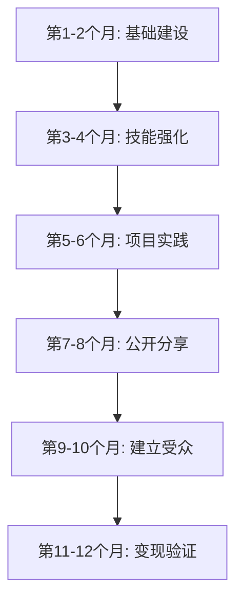

# 如何在6-12个月内超越99%的人

> [!info] 视频信息
> **作者**: [[Dan Koe]]
> **频道**: The Koe Cast
> **主题**: 个人成长、目标实现、一人企业
> **核心理念**: 通过明确的愿景、反愿景和系统化方法，在6-12个月内实现人生蜕变

---

## 核心观点概述

> [!abstract] 核心信息
> 大多数人之所以落后，是因为他们缺乏清晰度、沉迷于短期满足、追逐热门趋势而非解决真正的问题。超越99%的人的关键在于：**明确你不想要什么**，**建立清晰的愿景**，**构建可执行的系统**，以及**持续的自我教育**。

---

## 第一部分：反愿景 (Anti-Vision)

### 什么是反愿景？

> [!tip] 关键概念
> **反愿景**是对"你绝对不想过的生活"的残酷觉察。它让你能够利用负面能量，将努力指向积极的方向，并从内在动机出发采取行动。

反愿景是 [[Dan Koe]] 提出的核心概念之一，已经帮助了无数人找到前进的方向。

### 如何创建反愿景

1. **残酷地意识到你不想要什么**
   - 想象如果你什么都不改变，你的生活会变成什么样
   - 让这种不适感推动你前进

2. **识别要避免的路径**
   - 哪些习惯需要放弃？
   - 哪些干扰需要拒绝？
   - 哪些关系在消耗你？

3. **将反愿景写下来**
   - 详细描述你最不想经历的生活场景
   - 这将成为你行动的"负面燃料"

> [!warning] 重要提醒
> 当你构建反愿景时，你应该感到不舒服。这种不适感正是推动你改变的力量源泉。

### 反愿景的作用

| 功能 | 描述 |
|------|------|
| [[动机引擎]] | 提供持续的内在动力 |
| [[决策过滤器]] | 帮助过滤不符合目标的机会 |
| [[方向指引]] | 明确什么是你要远离的 |

---

## 第二部分：愿景 (Vision)

### 从反愿景到愿景

一旦你有了反愿景，下一步是**写出它的反面**——你的理想生活。

> [!example] 愿景构建方法
> 1. 把反愿景的每一条取反
> 2. 尽可能具体地描述你的梦想生活
> 3. 让你的大脑能够识别以前会错过的机会

### 为什么要设定宏大目标？

你设定宏大目标不是为了：
- ❌ 实用性
- ❌ 成就感

你设定宏大目标是为了：
- ✅ **愿景** - 看清方向
- ✅ **方向** - 知道往哪走
- ✅ **过滤** - 筛选机会

> [!quote] Dan Koe 语录
> "你不需要更多的动力，你需要更多的清晰度。你不需要更多的时间，你需要更多的专注。"

### 6组件框架

[[Dan Koe]] 建议将你的洞察组织成6个组件：

```
┌─────────────────────────────────────────────┐
│             6组件规划框架                    │
├─────────────────────────────────────────────┤
│ 1. 反愿景 - 你绝不想再经历的生活            │
│ 2. 愿景   - 你理想中的生活                  │
│ 3. 1年目标 - 1年后你的生活会是什么样        │
│ 4. 收入目标 - 具体的财务目标                │
│ 5. 专注目标 - 你要精通的领域                │
│ 6. 习惯系统 - 每日执行的行为                │
└─────────────────────────────────────────────┘
```

---

## 第三部分：系统胜过目标

### 为什么系统更重要？

> [!important] 核心洞察
> 虽然目标很重要，但真正确保你取得进步的是你创建的**日常系统**。系统提供结构和一致性，帮助你养成支持长期成功的习惯。

### 目标 vs 系统

| 目标 | 系统 |
|------|------|
| 指明终点 | 规划路径 |
| 提供方向 | 确保执行 |
| 激发动力 | 建立习惯 |
| 容易放弃 | 自动运行 |

### 构建有效系统的要素

1. **[[每日专注时间]]**
   - 每天2-4小时的纯粹专注
   - 一小时的专注就能彻底改变你的生活

2. **[[周回顾]]**
   - 审视愿景和反愿景需要添加什么
   - 确定本周可以做出的微小改进

3. **[[技能堆叠]]**
   - 持续学习与你目标相关的技能
   - 不仅是看教程，而是创建实际项目

---

## 第四部分：自我教育与技能建设

### 自我教育的力量

> [!tip] Dan Koe 的建议
> "保持安静3个月，专注于1个大目标，疯狂地自我教育，应用你学到的一切，尽可能多地失败。"

### 最简单的超越方式

承诺一段技能发展期：
- **时长**: 6-12个月
- **强度**: 每天2-4小时纯粹专注
- **方式**: 学习并构建

> [!warning] 避免的陷阱
> 不是无脑地看教程，而是创建**有质量的项目**——你自己、他人或企业能够真正受益的项目。

### 核心技能清单

根据 [[Dan Koe]] 的框架，以下技能值得投资：

- [[写作]] - 内容创作的基础
- [[营销]] - 传播你的价值
- [[销售]] - 将价值变现
- [[设计]] - 视觉呈现能力
- [[编程]] - 技术实现能力
- [[AI应用]] - 未来必备技能

---

## 第五部分：一人企业模式

### 新时代的机会

> [!success] 好消息
> 你不再需要：
> - 启动资金
> - 专家资质
> - 担心市场饱和
>
> 技术已经发展到只需要一个人、一个大脑和自我教育的习惯就能获得创造性收入。

### 四大支柱

[[一人企业]]的四大支柱：

```
        ┌──────────┐
        │   品牌   │ ← 你的故事
        └────┬─────┘
             │
    ┌────────┼────────┐
    │        │        │
┌───▼──┐ ┌──▼───┐ ┌──▼───┐
│ 内容 │ │ 产品 │ │ 营销 │
└──────┘ └──────┘ └──────┘
  地图     解决方案   体验
```

### 核心公式

> [!quote] 关键洞察
> "私下解决问题，叫做自我提升。公开解决问题，叫做商业。"

当你解决自己的问题并销售解决方案时，你就能跳过那99%追逐热点的人。

---

## 第六部分：操作步骤清单

### 立即行动指南

> [!todo] 第一周行动清单
> - [ ] 花1小时写下你的[[反愿景]]
> - [ ] 花1小时写下你的[[愿景]]
> - [ ] 确定你的1年目标
> - [ ] 列出需要学习的3个核心技能
> - [ ] 设定每日专注时间块

### 6-12个月路线图



### 每月里程碑

| 月份 | 重点 | 成果 |
|------|------|------|
| 1-2 | [[基础建设]] | 明确愿景、建立系统 |
| 3-4 | [[技能强化]] | 掌握1-2个核心技能 |
| 5-6 | [[项目实践]] | 完成2-3个实际项目 |
| 7-8 | [[公开分享]] | 开始在平台发布内容 |
| 9-10 | [[建立受众]] | 积累初始关注者 |
| 11-12 | [[变现验证]] | 获得第一批付费客户 |

---

## 第七部分：常见障碍与解决方案

### 为什么大多数人会失败？

> [!danger] 失败原因
> - 沉迷于数量而非质量
> - 为赚钱而创作，而非为创作而赚钱
> - 学习任何承诺快速赚钱的技能
> - 总是把他人放在首位
> - 从不在学校之外学习
> - 从不设定和追求自己的目标

### 解决方案框架

1. **定义你不想要什么** → 创建[[反愿景]]
2. **创建愿景** → 明确[[理想生活]]
3. **建立系统** → 设计[[每日流程]]
4. **重复基础** → 专注[[核心技能]]
5. **移除干扰** → 清除[[注意力小偷]]
6. **重新导向能量** → 投入[[成长领域]]
7. **停止期待快速结果** → 培养[[耐心心态]]
8. **拥抱终身精通** → 追求[[持续进步]]

---

## 关键语录收藏

> [!quote] 精选语录
>
> "变得残酷地意识到你不想要什么，以及如果什么都不改变你会走向何方。"
>
> "你不需要更多的动力，你需要更多的清晰度。"
>
> "私下解决问题，叫做自我提升。公开解决问题，叫做商业。"
>
> "每个月，休息一下，好好享受一些乐趣。强度的爆发是你超越其他人的方式。"

---

## 相关链接

- [[Dan Koe]] - 作者主页
- [[The Art of Focus]] - Dan Koe 的书籍
- [[一人企业模式]] - 商业框架
- [[反愿景方法论]] - 目标设定技术
- [[自我教育系统]] - 学习框架

---

## 参考资源

- [Dan Koe 官方网站](https://thedankoe.com/)
- [The Koe Letter 订阅](https://thedankoe.com/letters)
- [Dan Koe Twitter](https://x.com/thedankoe)

---

> [!success] 最终提醒
> 如果你坚持这个过程，你会对自己在6-12个月内走了多远感到震惊。关键不在于完美执行，而在于**持续行动**和**不断调整**。
